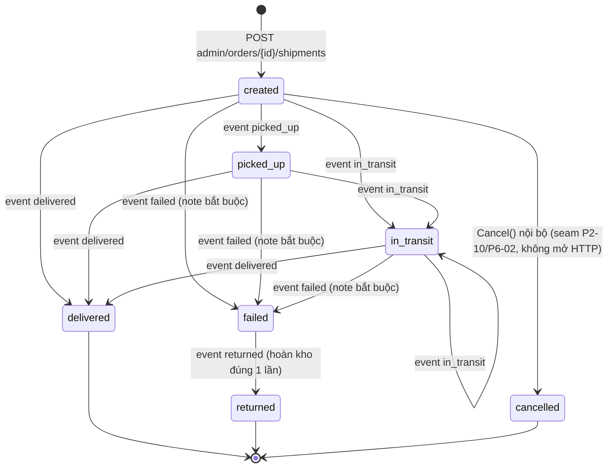

# P2-08: Shipments thủ công + sự kiện + delivered/failed + restock (BR-SHP-02..05, BR-ORD-07), giữ đúng trạng thái bán BR-SEO-21 khi giao thất bại/nhập lại

- **Trạng thái hồ sơ:** `G3 IMMUTABLE IMPLEMENTATION RECORD` (đã tích hợp lên `origin/main` `958b0c4acc2d1f49f533783d1889fe406117c950` sau `P2-04` PR `#53`; hoàn tất trước khi đóng băng manifest — không tự tham chiếu manifest SHA-256, commit SHA chưa publish, verdict G4 hay trạng thái CI/merge; **0** sửa đổi trên `docs/spec/*`, `apps/*`, `scripts/*`, migrations/snapshot).
- **Tier:** `A` — chạm trực tiếp xuất/nhập lại tồn kho thật (`inventory.stock_levels.on_hand`, `inventory.stock_movements`, bình quân gia quyền `BR-INV-05`), chốt giá vốn dòng đơn (`sales.order_lines.unit_cost_vnd`), tính tiền thu hộ `cod_amount_vnd` qua `OrderPaymentStatusCalculator` (`O3a = C`) & tạo đồng bộ `sales.payments(cod, awaiting_settlement)`, quyền quản trị `orders.write` + `[Audited]` che PII/ghi chú (`NFR-04`), và đồng bộ trạng thái bán hàng độc bản SEO (`BR-SEO-21` + `StorefrontInvalidate`).
- **Worktree/base:** `D:\tra-hien-p2-08`, nhánh `feature/p2-08-shipments`, approved base `origin/main` = `958b0c4acc2d1f49f533783d1889fe406117c950` (đã bao gồm `P2-01`, `P2-02`, `P2-03`, `P2-04` PR `#53`, `P2-05`, `P2-07` PR `#52`, `P2-13`, PR `#50` Workflow V2).
- **Readiness (scoped G1/G2):** `GO` — toàn bộ quyết định `GAP-P208-01 = A`, `GAP-P208-02 = A` (`Clarification only`), `ASSUMPTION-P208-01 = A` cùng `O1 = A`, `O3a = C`, `O3b = Phương án 3`, `BR-SEO-21`, `G16`, `G22`, `G30` đều ở trạng thái **`OWNER_APPROVED`** (đã ghi nhận tại [ADR-P2-01-phase2-contracts.md](../decisions/ADR-P2-01-phase2-contracts.md) §4.5 đợt 4).
  - Tái sử dụng baseline Full G1 tại `cadce575597738bf40ad7c45689482de5a5fbc3d` ([spec-inventory.md](../analysis/spec-inventory.md), [spec-gaps.md](../analysis/spec-gaps.md)), G2 nền ([conformance-review.md](../architecture/conformance-review.md)), và các hợp đồng Phase 2 tại [ADR-P2-01-phase2-contracts.md](../decisions/ADR-P2-01-phase2-contracts.md).
  - Các cập nhật đặc tả gần nhất trên `origin/main = 958b0c4` thuộc gói `P2-07` (`20031d4` — `O1 = A`, `O2 = A`, `O3a = C`, `O3b = Phương án 3`): đồng bộ `BR-SHP-02` (`cod_amount = (payment_method = cod) ? remaining_to_pay : 0`, đơn `0đ` → `0`) và `BR-SHP-03` (`delivery_failed` tính lại `payment_status`, bật `needs_refund` nếu `net > 0`). `P2-08` **không** sửa `docs/spec/*`.
  - Phụ thuộc trực tiếp đã merge trên `origin/main = 958b0c4`: `P2-01` (`85218d1`), `P2-05` (`862fbf0`), `P2-07` (`137dca8` — cung cấp `OrderPaymentStatusCalculator` và `IOrderPaymentLedgerReader`), `P2-04` (`958b0c4`).
- **Traceability:** xem Mục 1.2 và bảng ánh xạ code/test ở Mục 4–5.
- **Scope / out of scope:** xem Mục 1.3.
- **Migration/recovery:** **`none`** tại `P2-08`. Toàn bộ bảng `sales.shipments`, `sales.shipment_events`, `sales.payments`, `sales.refunds`, partial unique indexes (`ux_shipment_active_order`, `ux_shipment_tracking`) và quyền `tp_app` / `tp_readonly` đã được tạo tại `202611230421_P2_01_CrmSalesFinanceFoundation`, `202611230721_P2_05_InventoryReservations` và `202611260800_P2_07_RefundClassificationAndShipping`. `[Audited]` trên `Persistence.Shipment` là thuộc tính runtime C#, không thay đổi `AppDbContextModelSnapshot`. Khôi phục bằng cách revert commit code + OpenAPI/client + docs của nhánh `P2-08`.
- **Pre-freeze verification evidence:**
  - `./scripts/verify-linux.ps1 -Mode api -WriteBack` (`RESULT=PASS coverage=API`, `123` operations trên `958b0c4` + `P2-08`).
  - `./scripts/verify-linux.ps1 -Filter "FullyQualifiedName~Shipment|FullyQualifiedName~UniquePieceSold|FullyQualifiedName~AuditValuePolicy|FullyQualifiedName~OpenApi|FullyQualifiedName~CompiledArchitectureTests"` (`RESULT=FOCUSED_PASS coverage=FOCUSED_BACKEND`: `24/24` UnitTests, `38/38` ArchitectureTests, `124/124` IntegrationTests PG17 thật + `tp_app`, `0` fail, `0` skip, `OpenAPI/client are current.`).
  - Kết quả manifest-bound `FULL_ALL` và Dynamic Task Status nằm ngoài hồ sơ bất biến này (tại Unified Handoff Report / PR body).

---

## 1. Định danh đặc tả, quyết định Owner và ranh giới phạm vi

### 1.1 Quyết định Owner đã phê duyệt (`OWNER_APPROVED`)

**Gói quyết định Phase 2 (`2026-11-22`, Sự kiện B — `ADR-P2-01` §4.2):**
1. **`BR-SHP-02` / `BR-SHP-04` / `AC-P2-03`:** `POST /api/v1/admin/orders/{id}/shipments` xử lý `purpose = 'order'`, `provider = 'manual'` (giữ seam sạch cho `purpose = 'replacement'` ở `P2-10` theo `G30`). Đơn phải đang `confirmed`, chưa có shipment `purpose = 'order'` hoạt động (`ux_shipment_active_order`, bắt `23505` qua `SAVEPOINT`), chuyển đơn `confirmed → shipping` nguyên tử trong cùng transaction dưới khóa `L1 → L2 → L3 → L4` (`on_hand` giảm, `reserved` giảm, reservation sang `consumed`, ghi `stock_movements(sale)` kèm `unit_cost_vnd = avg_cost_vnd`, chốt `order_lines.unit_cost_vnd`, đồng bộ `BR-SEO-21` `sold_out_at` + `StorefrontInvalidate`, phát outbox `OrderShipped`).
2. **`G22` / `BR-ORD-07.1` / `AC-P2-07`:** Sự kiện `delivered` kiểm `shipped_at <= delivered_at <= now`; trong **cùng transaction** chuyển đơn sang `delivered`, nếu `order.PaymentMethod == "cod" && shipment.CodAmountVnd > 0` (và phòng vệ chưa có COD payment chưa void) thì tạo đồng bộ `sales.payments(method='cod', provider='manual', amount_vnd=shipment.CodAmountVnd, status='awaiting_settlement', confirmed_at=NULL)`. Phát outbox `OrderDelivered` đi qua đúng `CompositeOrderOutboxHandler` duy nhất của `P2-05`.
3. **`G16` / `BR-SHP-03` / `BR-SEO-21`:** Sự kiện `failed` (bắt buộc `note` → `422 failure_reason_required`) chuyển đơn `shipping → delivery_failed`, **chưa** cộng lại kho. Sự kiện `returned` (chỉ từ `failed`, chống cộng kho kép 2 lớp) nhập hoàn kho mọi dòng đơn với `movement_type = 'return_restock'`, **`ref_type = 'order'`, `ref_id = order.Id`** (tách biệt với `ref_type = 'return'` của `P2-10` để không lệch `C2` trong `BR-FIN-02`), `unit_cost_vnd = order_line.UnitCostVnd`, tính lại `avg_cost_vnd` (`BR-INV-05`), xóa `products.sold_out_at = NULL` + phát `StorefrontInvalidate` (`BR-SEO-21` → `"in_stock"`).

**Gói quyết định `2026-11-26` (`OWNER_APPROVED`, `Clarification only` — `0` sửa `docs/spec/*`):**
1. **`O1 = A` & `O3a = C` (`BR-SHP-02`, `BR-SHP-03`, `BR-PAY-02`):** Tái sử dụng duy nhất `OrderPaymentStatusCalculator` + `IOrderPaymentLedgerReader` của `P2-07` (không trùng công thức COD/sổ thanh toán): `cod_amount_vnd = order.PaymentMethod == "cod" ? calc.RemainingToPayVnd : 0` (xử lý đồng nhất đơn `0đ` → `0`, cọc 1 phần, hoàn thu thừa `effective_paid`). Bảo toàn tính lại `payment_status` của `P2-07` trong cả `TransitionLoadedOrderToShippingAsync` (self-heal đơn `0đ` cũ) và `TransitionLoadedOrderToDeliveryFailedAsync` (`delivery_failed` bật `NeedsRefund` khi `net > 0`).
2. **`GAP-P208-01 = A`:** Giữ `Shipment.Cancel()` ở tầng Domain (`created → cancelled`) làm seam cho `P2-10`/`P6-02`; **không mở route HTTP `cancelled`** ở `P2-08`. Cho phép chuyển tiến không lùi `created | picked_up | in_transit → in_transit | delivered | failed` (`picked_up` chỉ từ `created`; `returned` chỉ từ `failed`; `delivered | returned | cancelled` là terminal cho sự kiện).
3. **`GAP-P208-02 = A` (`Clarification only` theo `BR-SHP-03` `04-business-rules.md:230` & `ADR-P2-01` §4.5):** Chấp nhận trường tùy chọn `returnCostVnd?: long | null` (`>= 0`) trong `POST /api/v1/admin/shipments/{id}/events` **chỉ khi `status == "returned"`** (truyền giá trị ở trạng thái khác trả `400 validation_failed`); `PATCH /api/v1/admin/shipments/{id}` cho phép cập nhật/xóa `trackingCode?`, `shippingCostVnd?`, `returnCostVnd?` trên vận đơn khác `cancelled` (kể cả `delivered`/`failed`/`returned` theo `BR-SHP-05`).
4. **`ASSUMPTION-P208-01 = A`:** `POST /api/v1/admin/orders/{id}/shipments` chèn dòng `sales.shipment_events` khởi tạo (`status = 'created'`, `source = 'manual'`, `occurred_at = created_at`, `note = normalizedNote`, `created_by = staffId`) và trả `201 Created` (`Location: /api/v1/admin/shipments/{id}`) kèm `ShipmentDetailView`.

### 1.2 Truy vết nguồn đặc tả và mã định danh

- **Task ID:** `P2-08` ([07-roadmap.md](../spec/07-roadmap.md#L93), phụ thuộc `P2-05`, tích hợp cùng `P2-07` và `P2-04` trên `origin/main = 958b0c4`).
- **Tài liệu nguồn:**
  - [00-README.md](../spec/00-README.md) (`DEC-01`, `DEC-05`, `DEC-06`, `DEC-07`, `DEC-09`, `DEC-14`, `DEC-15`, `DEC-16`, `DEC-20`, `DEC-21`, `DEC-23`, `DEC-30`).
  - [01-requirements.md](../spec/01-requirements.md) (`FR-ORD-04`, `FR-PAY-02`, `FR-SHP-02`, `FR-SHP-03`, `FR-SHP-04`, `FR-PLT-01`, `NFR-01`, `NFR-02`, `NFR-04`, `NFR-07`, `NFR-08`, `NFR-09`).
  - [02-architecture.md](../spec/02-architecture.md) (§3 ranh giới module, §4 use case, §5.1 `IClock`, §5.2 giao dịch & khóa, §5.4 `[Audited]` & `AuditValuePolicy`, §5.5 outbox, §5.6 `IShippingProvider`, §5.8 `StorefrontInvalidate`, §6–§7 `AdminCookie`/CSRF/`orders.write`).
  - [03-database.md](../spec/03-database.md) & [schema.sql](../spec/schema.sql#L938-L1051) (`sales.payments`, `sales.shipments`, `sales.shipment_events`, `ux_shipment_active_order`, `ux_shipment_tracking`).
  - [04-business-rules.md](../spec/04-business-rules.md#L141-L233) (`BR-INV-04`, `BR-INV-05`, `BR-INV-09`, `BR-ORD-01..03`, `BR-ORD-07`, `BR-PAY-02`, `BR-SHP-02..05`, `BR-FIN-02`).
  - [05-api.md](../spec/05-api.md#L186-L188) (§4.4 ba endpoint vận đơn).
  - [09-seo.md](../spec/09-seo.md) (`BR-SEO-21`, `BR-SEO-81`).
- **Tiêu chí nghiệm thu trực tiếp:** `AC-P2-03` (`confirmed → shipping` qua HTTP) và `AC-P2-07` phần COD `awaiting_settlement` khi `delivered` (tương thích trực tiếp với `GET /api/v1/admin/payments/awaiting?type=cod` của `P2-07`; phần gom đối soát `cod_settlements` thuộc `P2-09`).

### 1.3 Phạm vi và Ngoài phạm vi

- **Trong phạm vi `P2-08`:** Aggregate `Shipment` + `ShipmentEventEntry` (`TeaPremium.Domain.Orders`), `IShippingProvider` + `ManualShippingProvider`, 3 endpoint Admin vận đơn (`orders.write` + CSRF + HTTPS + strict JSON `415`), tách `IOrderFulfillmentTransitions` dùng chung với `OrderCoreUseCases` (giữ nguyên `payment_status` recalculation của `P2-07`), `CodAwaitingSettlementDeliveredHook : IOrderDeliveredHook`, `RestockReturnedAsync(order.Id, "order", ...)` chống cộng kho kép 2 lớp + đồng bộ `BR-SEO-21`, `[Audited]` trên `Persistence.Shipment` + `AuditSaveChangesInterceptor` + `AuditValuePolicy("sales.shipments")`, port đọc `IOrderShipmentQueries` cho `P2-06`, cập nhật `ADR-P2-01` đợt 4 (`P2-08`), tái sinh `openapi.json` & `schema.ts`.
- **Ngoài phạm vi `P2-08`:** Tích hợp webhook GHN/GHTK (`P6-02`), đối soát COD hàng loạt (`P2-09`), đổi trả & `purpose = 'replacement'` HTTP (`P2-10`, chỉ để sẵn seam Domain/Hook `G30`), chỉ số/sở thích khách `P2-11`, gửi thông báo vận đơn `P2-13`/`P3-06`, referral `P5-05`, CRUD đơn Admin `P2-06`, UI Admin `P2-15`, P&L `P4-02`.

---

## 2. Máy trạng thái `sales.shipments` và ánh xạ sang `sales.orders`

| Thao tác / Sự kiện | Từ `shipment.status` hợp lệ | Đích & mốc thời gian | Ánh xạ `sales.orders` (`purpose = 'order'`) | Tác động Kho / Thanh toán / SEO / Outbox (cùng 1 tx) |
|---|---|---|---|---|
| `POST admin/orders/{id}/shipments` | *(chưa có active order shipment)* | `created` + dòng `shipment_events('created')` | `confirmed → shipping` (`shipped_at = now`) | Tính `cod_amount_vnd` qua `IOrderPaymentLedgerReader` + `OrderPaymentStatusCalculator` (`O3a = C`). Consume reservation (`BR-INV-04`), ghi `stock_movements(sale)`, chốt `order_lines.unit_cost_vnd`, `BR-SEO-21` (`sold_out_at` + `StorefrontInvalidate`), outbox `OrderShipped` |
| Event `picked_up` | `created` | `picked_up` (`picked_up_at = occurredAt`) | Giữ `shipping` | Ghi `shipment_events('picked_up')` + audit `sales.shipments` |
| Event `in_transit` | `created`, `picked_up`, `in_transit` | `in_transit` (giữ `picked_up_at`) | Giữ `shipping` | Ghi `shipment_events('in_transit')` + audit (nếu đổi status) |
| Event `delivered` | `created`, `picked_up`, `in_transit` | `delivered` (`delivered_at = occurredAt`, terminal) | `shipping → delivered` (`delivered_at = occurredAt`) | Không đổi kho. `CodAwaitingSettlementDeliveredHook`: tạo đồng bộ `sales.payments(cod, manual, cod_amount_vnd, awaiting_settlement, confirmed_at = NULL)` nếu `cod && cod_amount_vnd > 0` và chưa có COD payment chưa void. Outbox `OrderDelivered` qua 1 `CompositeOrderOutboxHandler` duy nhất |
| Event `failed` | `created`, `picked_up`, `in_transit` | `failed` (`failed_at = occurredAt`, bắt buộc `note` → `422 failure_reason_required`) | `shipping → delivery_failed` (`failed_at = occurredAt`, tính lại `payment_status` theo `O1 = A` / `O3a = C`) | **Chưa cộng kho** (`on_hand` & `sold_out_at` giữ nguyên). Outbox `OrderDeliveryFailed` |
| Event `returned` | **Chỉ từ `failed`** | `returned` (`returned_at = occurredAt`, cập nhật `return_cost_vnd` nếu truyền, terminal) | Giữ `delivery_failed` (`order_lines.returned_quantity` giữ `0`) | Chống cộng kho kép 2 lớp (khóa `L1 → L1b` + kiểm `HasOrderReturnRestockMovementAsync`). Gọi `RestockReturnedAsync(order.Id, "order", ...)` (`G16`: `ref_type='order'`, `unit_cost_vnd = order_line.UnitCostVnd`), tính lại `avg_cost_vnd` (`BR-INV-05`), xóa `products.sold_out_at = NULL` + `StorefrontInvalidate` (`BR-SEO-21` → `"in_stock"`) |

---

## 3. Hợp đồng HTTP, Thứ tự khóa `L1 → L4`, Bảo mật & Audit

1. **Ba endpoint Admin (`05-api.md:186-188`):**
   - `POST /api/v1/admin/orders/{id:guid}/shipments` → `201 Created` (`Location: /api/v1/admin/shipments/{id}`) + `ShipmentDetailView`
   - `PATCH /api/v1/admin/shipments/{id:guid}` → `200 OK` + `ShipmentDetailView` (JSON partial: bắt buộc ≥ 1 trường trong `trackingCode`, `shippingCostVnd`, `returnCostVnd`; vắng mặt giữ nguyên; `null` xóa về `NULL`; `trackingCode: ""` hoặc số âm hoặc trường lạ → `400 validation_failed`)
   - `POST /api/v1/admin/shipments/{id:guid}/events` → `200 OK` + `ShipmentDetailView` (`status ∈ {picked_up, in_transit, delivered, failed, returned}`, `occurredAt` bắt buộc có offset ISO-8601, `note?`, `returnCostVnd?` chỉ hợp lệ khi `status == "returned"` và `>= 0`)
   - Tất cả bắt buộc HTTPS (`400 https_required`), `AdminSecurity.Ready`, quyền `orders.write` (`owner`/`sales` được phép, `content` `403 forbidden`), `X-CSRF-TOKEN` (`400 csrf_invalid`), `Content-Type: application/json` (`415 unsupported_media_type`), `AllowDuplicateProperties = false`, `UnmappedMemberHandling = Disallow`, `NumberHandling = Strict`, giới hạn body `<= 128 KiB`.
   - `ShipmentDetailView` không chứa `unitCostVnd` / `avgCostVnd` / `grossProfitVnd` (`02-architecture.md:235`).
2. **Thứ tự khóa một chiều (chống deadlock & lồng `EfUnitOfWork` `R-P208-01`):**
   - `L1 sales.orders (FOR UPDATE)` → `L1b sales.shipments (FOR UPDATE)` → `L2 catalog.products (ORDER BY id FOR NO KEY UPDATE)` → `L3 catalog.variants (ORDER BY id FOR UPDATE)` → `L4 inventory.stock_levels (ORDER BY variant_id FOR UPDATE)`.
   - `IOrderFulfillmentTransitions` (`OrderFulfillmentTransitions`) thực thi trong transaction đang mở của caller, dùng chung cho cả `OrderCoreHandlers` (`P2-05`) và `ShipmentHandlers` (`P2-08`).
3. **`SAVEPOINT` cho 2 Partial Unique Index (`23505`):**
   - `EfShipmentRepository.InsertAsync` và `SaveUpdatedAsync` bọc `SaveChangesAsync` trong `SAVEPOINT`, bắt `23505` cho `ux_shipment_active_order` (`409 active_shipment_exists`) và `ux_shipment_tracking` (`409 tracking_code_exists`), rollback savepoint và detach mọi entity mới phát sinh (kể cả `AuditLog` từ interceptor) để không rơi vào `25P02`.
4. **Audit fail-closed (`sales.shipments`):**
   - Gắn `[TeaPremium.Domain.Audited]` chỉ trên `Persistence.Shipment` (không gắn lên `ShipmentEvent`), bổ sung `or Shipment` vào `AuditSaveChangesInterceptor.cs:67` (giữ nguyên `StockLevel or Customer or CustomerAddress or Interaction or Payment or Refund or ReturnRequest`), và thêm allowlist fail-closed cho `"sales.shipments"` tại `AuditValuePolicy.cs` (luôn che `carrier_name`, `tracking_code`, `note` thành `"[redacted]"`).

---

## 4. Danh mục tệp triển khai (`28` tệp: `12` tạo mới, `16` cập nhật)

Không chạm `docs/spec/**`, không tạo migration mới, không sửa `apps/**`, không sửa `scripts/**`.

### 4.1 `TeaPremium.Domain` (`3` tệp: `2` mới, `1` sửa)
1. [ShipmentConstants.cs](../../backend/src/TeaPremium.Domain/Orders/ShipmentConstants.cs) *(mới)* — `ShipmentPurpose`, `ShippingProviderCode`, `ShipmentStatus`, `ShipmentEventSource` (tái dùng `PaymentMethod` / `PaymentProvider` / `PaymentRecordStatus` sẵn có từ `PaymentConstants.cs`).
2. [Shipment.cs](../../backend/src/TeaPremium.Domain/Orders/Shipment.cs) *(mới)* — aggregate `Shipment`, `ShipmentEventEntry`, `ComputeOrderCodAmountVnd(string, OrderPaymentCalculation)` tái dùng trực tiếp `OrderPaymentStatusCalculator` của `P2-07`, `CreateForOrder`, `CreateForReplacement` (seam `G30`), `UpdateMetadata`, `RecordEvent`, `Cancel` (seam Domain-only).
3. [Order.cs](../../backend/src/TeaPremium.Domain/Orders/Order.cs) *(sửa)* — thêm tham số tùy chọn `DateTimeOffset? now = null` cho `MarkDeliveryFailed` để kiểm `shipped_at <= failed_at <= now` tương đồng `MarkDelivered`.

### 4.2 `TeaPremium.Application` (`5` tệp: `3` mới, `2` sửa)
4. [ShippingProviderContracts.cs](../../backend/src/TeaPremium.Application/Orders/ShippingProviderContracts.cs) *(mới)* — `IShippingProvider` và model request/result (`02-architecture.md` §5.6).
5. [ShipmentContracts.cs](../../backend/src/TeaPremium.Application/Orders/ShipmentContracts.cs) *(mới)* — `IShipmentRepository`, `IOrderShipmentQueries`, `IReplacementShipmentHook`, `ShipmentDetailView`, `ShipmentEventView`, `PatchShipmentChanges` (tái sử dụng `IOrderPaymentLedgerReader` từ `TeaPremium.Application.Payments`).
6. [ShipmentUseCases.cs](../../backend/src/TeaPremium.Application/Orders/ShipmentUseCases.cs) *(mới)* — commands, validators, `ShipmentHandlers` và `CodAwaitingSettlementDeliveredHook : IOrderDeliveredHook`.
7. [OrderContracts.cs](../../backend/src/TeaPremium.Application/Orders/OrderContracts.cs) *(sửa)* — thêm `IOrderFulfillmentTransitions`.
8. [OrderCoreUseCases.cs](../../backend/src/TeaPremium.Application/Orders/OrderCoreUseCases.cs) *(sửa)* — tách `OrderFulfillmentTransitions` bảo toàn nguyên vẹn logic tính lại `payment_status` của `P2-07`, và ủy quyền `MarkOrderShipping` / `MarkOrderDelivered` / `MarkOrderDeliveryFailed`.

### 4.3 `TeaPremium.Infrastructure` (`8` tệp: `2` mới, `6` sửa)
9. [ManualShippingProvider.cs](../../backend/src/TeaPremium.Infrastructure/Orders/ManualShippingProvider.cs) *(mới)* — `IShippingProvider` cho `provider = "manual"`.
10. [EfShipmentRepository.cs](../../backend/src/TeaPremium.Infrastructure/Orders/EfShipmentRepository.cs) *(mới)* — `EfShipmentRepository` (`FOR UPDATE`, `SAVEPOINT` 23505 kèm detach `AuditLog`, `HasOrderReturnRestockMovementAsync`, `HasNonVoidedCodPaymentAsync`, `InsertAwaitingCodPaymentAsync`) và `EfOrderShipmentQueries`.
11. [OrdersRegistration.cs](../../backend/src/TeaPremium.Infrastructure/Orders/OrdersRegistration.cs) *(sửa)* — đăng ký DI cho `IOrderFulfillmentTransitions`, `ManualShippingProvider`, `EfShipmentRepository`, `EfOrderShipmentQueries`, `CodAwaitingSettlementDeliveredHook`; giữ đúng `1` `CompositeOrderOutboxHandler` cho mỗi `Order*`.
12. [EfOrderRepository.cs](../../backend/src/TeaPremium.Infrastructure/Orders/EfOrderRepository.cs) *(sửa nhẹ)* — thêm alias `PersistenceShipment` tránh xung đột tên với `TeaPremium.Domain.Orders.Shipment`.
13. [EfPaymentStores.cs](../../backend/src/TeaPremium.Infrastructure/Payments/EfPaymentStores.cs) *(sửa nhẹ)* — thêm alias `PersistenceShipment` tránh xung đột tên với `TeaPremium.Domain.Orders.Shipment`.
14. [CrmSalesFinanceEntities.cs](../../backend/src/TeaPremium.Infrastructure/Persistence/CrmSalesFinanceEntities.cs) *(sửa)* — gắn `[TeaPremium.Domain.Audited]` lên `Shipment`.
15. [AuditSaveChangesInterceptor.cs](../../backend/src/TeaPremium.Infrastructure/Persistence/AuditSaveChangesInterceptor.cs) *(sửa)* — thêm `or Shipment` tại dòng `67`.
16. [AuditValuePolicy.cs](../../backend/src/TeaPremium.Infrastructure/Persistence/AuditValuePolicy.cs) *(sửa)* — thêm allowlist fail-closed cho `"sales.shipments"`.

### 4.4 `TeaPremium.Api` & `packages/api-client` (`6` tệp: `2` mới, `4` sửa/tái sinh)
17. [ShipmentEndpoints.cs](../../backend/src/TeaPremium.Api/Orders/ShipmentEndpoints.cs) *(mới)* — `MapShipments()` cho 3 endpoint vận đơn.
18. [ShipmentOpenApi.cs](../../backend/src/TeaPremium.Api/Orders/ShipmentOpenApi.cs) *(mới)* — transformer OpenAPI khóa `additionalProperties: false`, required/nullable, `minimum: 0`, enum chuẩn.
19. [ProblemMapping.cs](../../backend/src/TeaPremium.Api/Middleware/ProblemMapping.cs) *(sửa)* — bổ sung `"active_shipment_exists"`, `"tracking_code_exists"`, `"reservation_mismatch"` vào `ConflictBusinessCodes` (`409`).
20. [Program.cs](../../backend/src/TeaPremium.Api/Program.cs) *(sửa)* — đăng ký `ShipmentOpenApi.TransformAsync` và `app.MapShipments()` (bảo toàn đầy đủ `InteractionOpenApi` và `MapCustomerInteractions` của `P2-04`).
21. [openapi.json](../../packages/api-client/openapi.json) *(tái sinh tự động qua `./scripts/verify-linux.ps1 -Mode api -WriteBack` — `123` operations)*.
22. [schema.ts](../../packages/api-client/src/generated/schema.ts) *(tái sinh tự động qua `./scripts/verify-linux.ps1 -Mode api -WriteBack`)*.

### 4.5 Tests & Tài liệu quyết định/hồ sơ (`6` tệp: `3` mới, `3` sửa)
23. [ShipmentStateMachineTests.cs](../../backend/tests/TeaPremium.UnitTests/ShipmentStateMachineTests.cs) *(mới)* — `9` method / `23` ca unit test (`U01`–`U09`).
24. [ShipmentsApiAndLifecycleTests.cs](../../backend/tests/TeaPremium.IntegrationTests/ShipmentsApiAndLifecycleTests.cs) *(mới)* — `13` method integration test (`I01`–`I12`, gồm `I06b` concurrent `delivered` và đơn COD `0đ`).
25. [AuditValuePolicyTests.cs](../../backend/tests/TeaPremium.IntegrationTests/AuditValuePolicyTests.cs) *(sửa)* — kiểm allowlist và redaction PII cho `sales.shipments` (bảo toàn toàn bộ test `crm.interactions` của `P2-04`).
26. [OpenApiTests.cs](../../backend/tests/TeaPremium.IntegrationTests/OpenApiTests.cs) *(sửa)* — cập nhật `totalOperations` `120 → 123` trên base `958b0c4` và kiểm schema/enum của 3 route vận đơn (bảo toàn toàn bộ kiểm tra `P2-04`).
27. [ADR-P2-01-phase2-contracts.md](../decisions/ADR-P2-01-phase2-contracts.md) *(sửa)* — ghi nhận đợt 4 (`2026-11-26`) chuyển riêng 3 mục `GAP-P208-01 = A`, `GAP-P208-02 = A`, `ASSUMPTION-P208-01 = A` (`Clarification only`) sang `OWNER_APPROVED` (bảo toàn cập nhật `P2-04`, không nâng trạng thái mục chưa duyệt nào khác).
28. [p2-08-implementation.md](p2-08-implementation.md) *(hồ sơ bất biến hiện tại, không tự tham chiếu)*.

---

## 5. Danh mục kiểm thử (`0` skipped)

### 5.1 Unit Tests (`ShipmentStateMachineTests.cs` — `9` methods / `23` ca thực thi)

| Mã | Tên test method | Số ca | Luật & bất biến chứng minh |
|---|---|---:|---|
| `U01` | `BrShp02ValidForwardTransitionsUpdateTimestampsAndAppendEvents` | 4 | Chuyển tiến hợp lệ (`created → picked_up → in_transit → delivered`, `created → delivered`, `created → failed → returned`, nhiều chặng `in_transit`), cập nhật đúng mốc thời gian và append events. |
| `U02` | `InvalidAndBackwardTransitionsThrowInvalidStatusTransition` | 12 | Chặn chuyển lùi, rời trạng thái terminal (`delivered`/`returned`), nhảy thẳng sang `returned` chưa qua `failed`, và `failed → delivered/in_transit/picked_up/failed`. |
| `U03` | `CancelShipmentAllowedOnlyFromCreatedAndRejectsAfterProgress` | 1 | Seam `Cancel()` chỉ cho phép từ `created`, `cancelled` là terminal, từ chối ở mọi trạng thái đã tiến triển. |
| `U04` | `BrShp02ComputeOrderCodAmountVndHandlesCodDepositOverpaidZeroVndAndBankTransfer` | 1 | Tái dùng `OrderPaymentStatusCalculator` cho COD chưa cọc, có cọc, hoàn thu thừa (`effective_paid`), trả dư, đơn `0đ` (`O3a = C`), và `bank_transfer` (`0`). |
| `U05` | `EventTimestampsEnforceMonotonicBoundsAndRejectFuture` | 1 | Chặn tương lai, `< created_at`, `delivered_at < shipped_at` (`invalid_delivered_at`), `in_transit < picked_up_at`, `returned_at < failed_at`. |
| `U06` | `FailedEventRequiresNonEmptyReasonAndReturnCostAllowedOnlyOnReturned` | 1 | `failed` thiếu/trắng `note` → `failure_reason_required`; `returnCostVnd` trên trạng thái khác `returned` hoặc âm → `validation_failed`; `0` và dương trên `returned` hợp lệ. |
| `U07` | `UpdateMetadataNormalizesTrackingCodeAndRejectsCancelledShipment` | 1 | Trim `trackingCode`, chặn `""` ở PATCH, xóa về `null`, cho phép sửa trên `delivered`/`returned` (`BR-SHP-05`), chặn trên `cancelled`. |
| `U08` | `CreateForReplacementRequiresReturnRequestIdAndZeroCodSeamG30` | 1 | Seam `purpose = 'replacement'` bắt buộc `returnRequestId != Guid.Empty`, `cod_amount_vnd = 0`. |
| `U09` | `OrderMarkDeliveryFailedEnforcesTimestampBoundsWhenNowProvided` | 1 | `Order.MarkDeliveryFailed` kiểm `shipped_at <= failed_at <= now` khi truyền `now`. |

### 5.2 Integration Tests trên PostgreSQL 17 thật (`13` methods ở `ShipmentsApiAndLifecycleTests.cs` + `AuditValuePolicyTests` + `OpenApiTests`)

| Mã | Tên test method | Nội dung kiểm chứng trên PostgreSQL 17 (`tp_app` runtime + `HttpClient`) |
|---|---|---|
| `I01` | `AcP203CreateShipmentTransitionsOrderToShippingConsumesStockLocksUnitCostAndEmitsOutbox` | `AC-P2-03` & `BR-SHP-02`: `201 Created` + `Location`, đơn `shipping`, reservation `consumed`, `stock_movements(sale)`, khóa `order_lines.unit_cost_vnd`, `shipment_events('created')`, outbox `OrderShipped`, `IOrderShipmentQueries`. |
| `I02` | `CreateShipmentRejectsUnconfirmedOrUnpaidBankTransferOrderWithZeroSideEffects` | Từ chối đơn `pending`, `cancelled`, `confirmed + bank_transfer + unpaid` (`409 invalid_status_transition`), `0` side effect. |
| `I03` | `BrShp04ActiveOrderShipmentAndTrackingUniquenessEnforcedIncludingConcurrentRaceViaSavepoint` | `SAVEPOINT` bắt `23505` `ux_shipment_active_order` & `ux_shipment_tracking` (`0` leak `AuditLog`/`25P02`), `8` request song song `POST .../shipments` → `1` `201` + `7` `409`, trùng tracking trên `POST`/`PATCH` → `409 tracking_code_exists`, `trackingCode = null` cho nhiều đơn hợp lệ. |
| `I04` | `PatchShipmentPartialUpdateAndClearNullableFieldsWorksAcrossLifecycleAndAuditsRedacted` | Partial update, xóa về `null`, cập nhật sau `delivered` (`BR-SHP-05`), kiểm `platform.audit_logs` đầy đủ cột số/default và che sạch `carrier_name`, `tracking_code`, `note`. |
| `I05` | `AcP207DeliveredCodOrderCreatesAwaitingSettlementPaymentInSameTransactionAndProcessesOutbox` | COD có đặt cọc qua `P2-07` → `cod_amount_vnd = remaining_to_pay`, `picked_up` → `in_transit` → kiểm `422 invalid_delivered_at` → `delivered` tạo đúng 1 `sales.payments(cod, awaiting_settlement, confirmed_at = NULL)`, khớp `GET admin/payments/awaiting?type=cod`, xử lý `OrderDelivered` qua đúng 1 `CompositeOrderOutboxHandler`. |
| `I06` | `DeliveredBankTransferPrepaidCodAndZeroVndCodOrdersDoNotCreateCodPayment` | `bank_transfer` đã `paid`, COD đã trả đủ 100%, và **đơn COD `0đ` (`O3a = C`)** → `cod_amount_vnd = 0`, `delivered` sinh `0` dòng `sales.payments(cod)`. |
| `I06b` | `ConcurrentDeliveredEventsCreateAtMostOneCodPaymentAndOneOrderDeliveredOutboxEvent` | `8` request song song `delivered` qua barrier → đúng `1` `200`, `7` `409`, tối đa `1` COD payment và `1` outbox `OrderDelivered`. |
| `I07` | `G16BrShp03FailedDoesNotRestockAndRecalculatesPaymentStatusThenReturnedRestocksOnceWithOrderRefTypeAndWeightedAverage` | `failed` thiếu note `422`, `returnCostVnd` sai status `400`, `failed` không cộng kho + tính lại `payment_status` (`O1 = A` tương thích hoàn tiền `cancellation` của `P2-07`), nhập lô mới đổi `avg_cost_vnd`, `returned` cộng kho đúng 1 lần với `ref_type = 'order'` + `unit_cost_vnd = order_line.unit_cost_vnd` + tính lại `avg_cost_vnd` (`BR-INV-05`). |
| `I08` | `ReturnedEventBlocksSecondCallAndConcurrentDuplicateNeverDoubleRestocks` | `8` request song song `returned` qua barrier + gọi tuần tự lần 2 → đúng `1` `200`, `7` `409`, cộng kho đúng 1 lần. |
| `I09` | `BrSeo21UniquePieceShippedBecomesSoldFailedStaysSoldReturnedRestoresInStockAndClearsSoldOutAt` | Vòng đời HTTP `BR-SEO-21` đầy đủ trên ấm độc bản: `confirmed` (`out_of_stock`) → `shipments` (`sold`, `sold_out_at != null`) → `failed` (giữ `sold`) → `returned` (`in_stock`, `sold_out_at = null`, `StorefrontInvalidate`) → đặt và giao lại lần 2 thành công. |
| `I10` | `AfterFailedShipmentOrderCannotCreateSecondShipmentBecauseDeliveryFailedIsTerminal` | Đơn `delivery_failed` từ chối tạo shipment thứ 2 (`409 invalid_status_transition`, `BR-ORD-03`). |
| `I11` | `SecurityAndPermissionsEnforceOwnerAndSalesWriteBlockContentCsrfAndUnauthenticated` | `owner`/`sales` được phép; `content` `403`; ẩn danh `401`; thiếu CSRF `400`; HTTP thường `400 https_required`; sai `Content-Type` `415`; `occurredAt` thiếu offset `400`. |
| `I12` | `LockOrderConcurrencyCreateShipmentAndReturnedDoNotDeadlockWithCatalogOrMultiVariantOrders` | Song song tạo vận đơn + `returned` nhiều biến thể ngược thứ tự + khóa sản phẩm `EfProductStore` → `0` deadlock `40P01`, `IInventoryQueries.AlertsAsync` & `ReconcileInventory.RunOnceAsync` báo `0` mismatch. |

---

## 6. Rủi ro đã khóa chặn và bàn giao liên task

- **Các rủi ro đã triệt tiêu:** `R-P208-01` (lồng `EfUnitOfWork` — giải quyết bằng `IOrderFulfillmentTransitions`), `R-P208-02` (`[Audited]` `OnAdd` defaults trên `Shipment` — bổ sung `or Shipment` tại `AuditSaveChangesInterceptor.cs:67`), `R-P208-03` (`tracking_code = ""` — chuẩn hóa `null` ở `POST`, cấm rỗng ở `PATCH`), `R-P208-04` (`cod_amount_vnd == 0` — không chèn `sales.payments`), `R-P208-05` (`OpenApiTests` — cập nhật `120 → 123` trên `958b0c4`).
- **Điểm bàn giao cho các task kế tiếp:**
  - `P2-06`: tái dùng `IOrderShipmentQueries.ListByOrderIdAsync` cho `GET /api/v1/admin/orders/{id}`.
  - `P2-09`: đối soát hàng loạt `sales.payments(method='cod', status='awaiting_settlement')` sinh bởi `CodAwaitingSettlementDeliveredHook`.
  - `P2-10`: tái dùng seam `Shipment.CreateForReplacement`, `Shipment.Cancel`, `IReplacementShipmentHook` (`G30`) mà không cần sửa lại lõi `P2-08`.
  - `P2-11` / `P5-05` / `P2-13` / `P3-06`: đăng ký `IOrderOutboxStep` trên `CompositeOrderOutboxHandler` duy nhất (`G22`).
  - `P4-02`: tách `return_restock` `ref_type = 'order'` (`P2-08`, `G16`) khỏi `ref_type = 'return'` (`P2-10`) trong công thức `C2` (`BR-FIN-02`).
